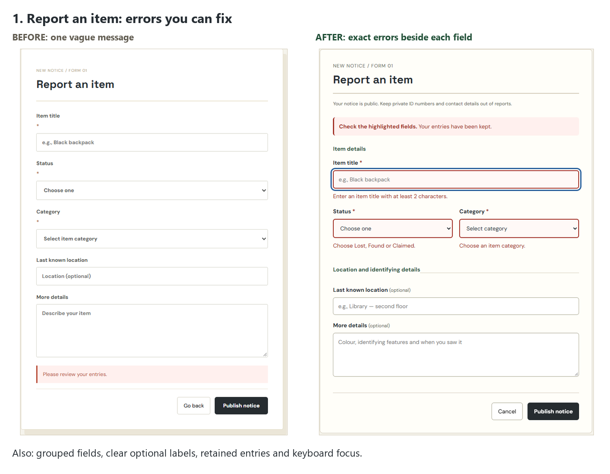
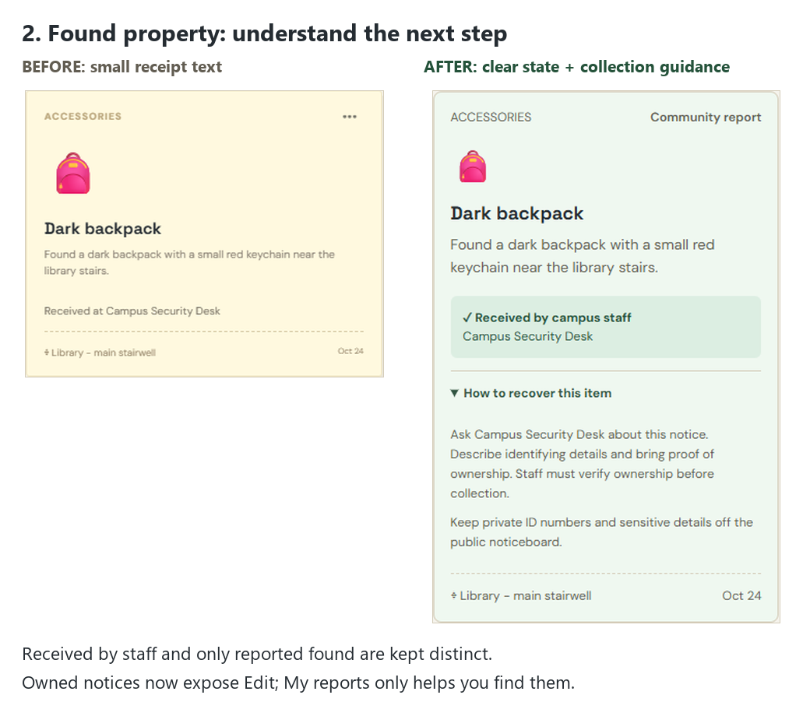
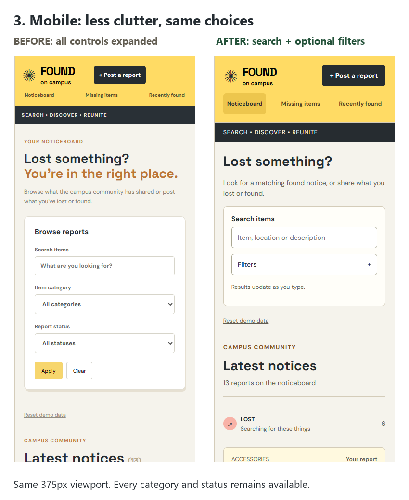
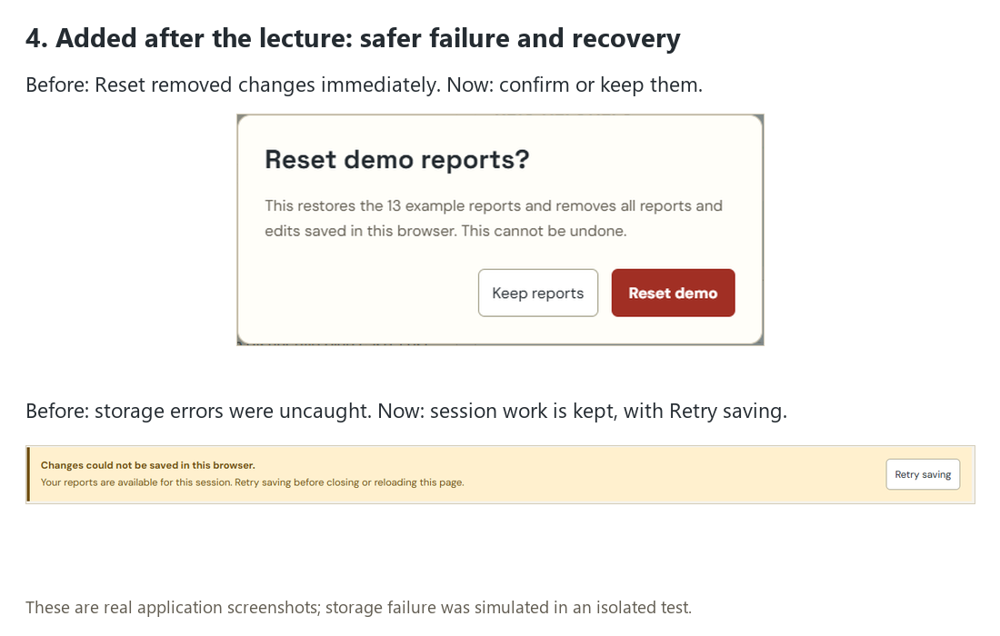

# Everything changed from the original starter

Compared with upstream starter commit `a86683a`. The first implementation was committed as `54225bf`; the lecture review extends that work on the same submission branch and pull request.

## 1. Reporting and correcting mistakes

- Replaced the generic “Please review your entries” failure with specific errors beside the title, status and category fields.
- Show all invalid required fields together, connect messages to controls using accessible attributes, and move keyboard focus to the first invalid field.
- Preserve typed values after a failed submission.
- Retain the minimum two-character title, valid category/status choices and duplicate title-at-location rule. Normalize case and surrounding spaces when checking duplicates; ignore the current report while editing it.
- Explain duplicate reports without incorrectly assuming the existing notice belongs to the current user.
- Clearly label optional fields and provide useful examples.
- Group the full-page form into Item details and Location and identifying details.
- Keep one primary form action, Publish notice or Save report; remove the competing header Post button while the form is open.
- Keep public-report privacy guidance visible on small screens, adapt the location label for found reports, and make the primary action full width on mobile.
- Show accurate contextual guidance for Lost/Found/Claimed. When editing a received item, name the existing collection point and explain that its record is retained.
- Make the posting success message match the report status, with handover instructions only for found reports.

## 2. Search, filtering and recovery from no matches

- Retain immediate search across item title, location and description; trim the search and ignore letter case.
- Remove the redundant Apply button and explicitly explain that results update as the user types.
- Show a live result count and total count when filters are active.
- Preserve all category and status filters. Show only the selected status section when one is chosen.
- Add My reports only, with visible ownership labels.
- Add removable chips for search, category, status and ownership filters; each chip clears only its own condition.
- On mobile, keep Search immediately available and place secondary filters in a keyboard-accessible disclosure with an active count. Closing it keeps the chosen values and visible chips.
- Explain no matches and offer Clear filters or Post a report. Keep Clear filters for restoring all records.
- Give header navigation a visible selected state. Noticeboard restores the full board, while Missing items and Recently found choose the intended status without stale filters.

## 3. Recovery guidance and discoverable editing

- Make receipt state prominent and readable: Received by campus staff, Reported found only, or Marked claimed.
- Show the existing collection point only when staff receipt is recorded.
- Add expandable How to recover this item instructions, explaining verification before collection or asking users to confirm receipt first.
- Retain the distinction between a community notice and property actually held by staff. New found reports never manufacture staff receipt.
- Replace hidden three-dot editing with a direct Edit your report action on owned notices. Other students' notices have no edit action, and the application retains the ownership check when editing/saving.
- Preserve item ID, original date, emoji and collection metadata when saving an edit.

## 4. Consistent visuals and accessibility

- Keep the original yellow Found on campus brand, warm background and independent notice cards.
- Replace layered one-off CSS overrides with a readable stylesheet using shared font, spacing, radius, colour and state tokens.
- Give Lost, Found and Claimed cards consistent status colours, while keeping text labels so colour is not the only indicator.
- Increase small text sizes and improve text/control contrast, spacing and touch targets; remove decorative card rotation.
- Add a skip link, explicit field labels, visible keyboard focus, status announcements, accessible disclosure state and named icon actions.
- Adapt board columns and form layout for desktop, tablet and phone widths. Do not automatically scroll a fresh mobile visit past the search controls.

## 5. Data safety and real-world failure

- Add a short native reset-confirmation dialog describing exactly what is removed. Keep reports receives initial focus; Cancel/Keep reports and Escape leave data intact. Confirmed Reset demo restores all 13 sample records.
- Catch browser-storage write failures rather than allowing an uncaught error.
- Retain in-memory session work, explain that it has not been saved, and offer Retry saving. When storage recovers, Retry saves the current reports and clears the warning.
- Keep the application as a localStorage demo. No server, MongoDB, contact exchange, identity verification or real staff workflow was introduced.

## 6. Evidence, documentation, checks and delivery

- Capture original and final screenshots for the board, validation, search, empty results and mobile views, plus successful posting, duplicate rejection, receipt states, reset confirmation and storage failure.
- Add visual before/after comparisons using actual application screenshots.
- Write three brief usability justifications, demonstration steps, pre-implementation alternatives and a rejected/refined one-click Claim suggestion in DESIGN-NOTES.md and SUBMISSION.md.
- Review all 34 lecture pages and map the six concepts, decisions and trade-offs in LECTURE-REVIEW.md. The local lecture PDF is not uploaded to GitHub.
- Initially pass 20 browser checks; after lecture improvements, pass 46 checks covering normal and unsuccessful flows, keyboard controls, storage failure/retry and widths of 375, 768, 1024 and 1440 pixels. Verify the production build and diff formatting.
- Replace native build-tool dependencies with compatible official WebAssembly variants after this environment blocked native executable downloads. Keep React and Vite; verify a clean dependency installation.
- Produce the complete submission ZIP, open the project in VS Code, and run it locally at http://localhost:5173/.
- Create the personal fork `yousefgaffar12-debug/Task-4.4`, push `submission/uiux-rescue`, and submit upstream pull request #42. Follow-up changes update that same submission; instructor review/acceptance is outside this task.

## Visual comparisons

