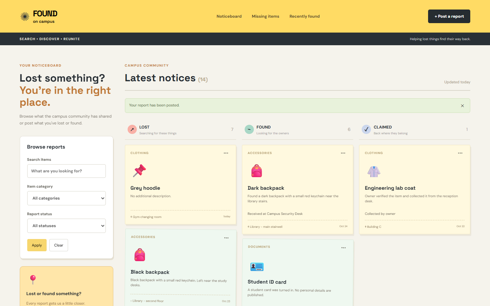
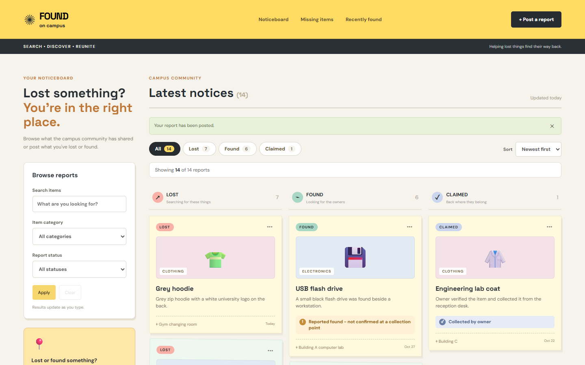
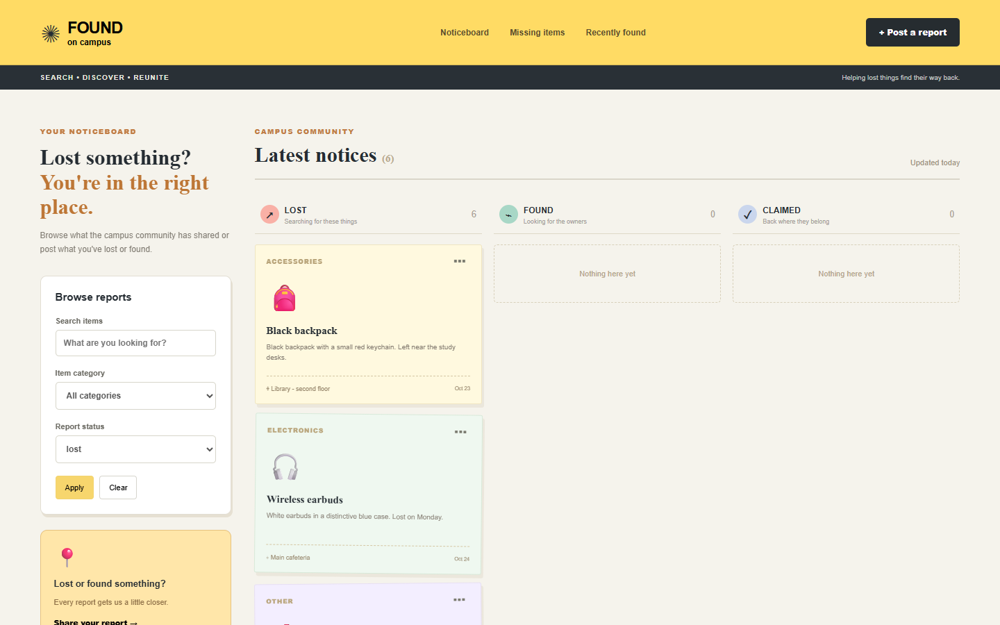
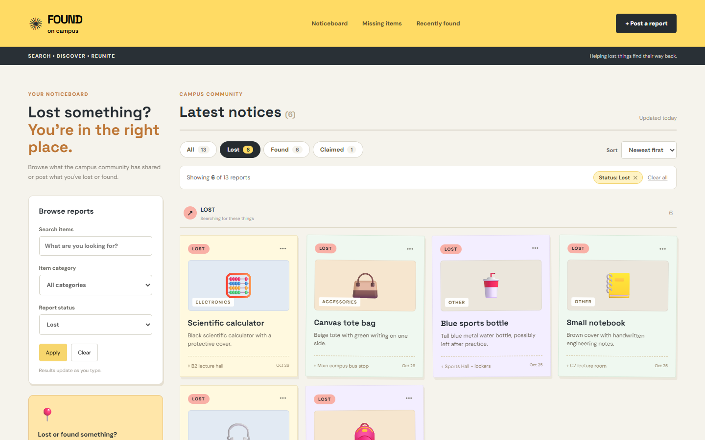
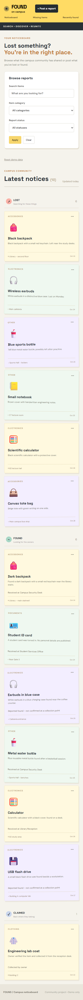
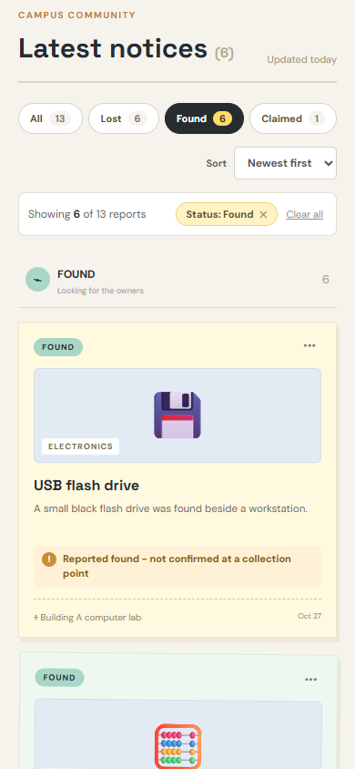
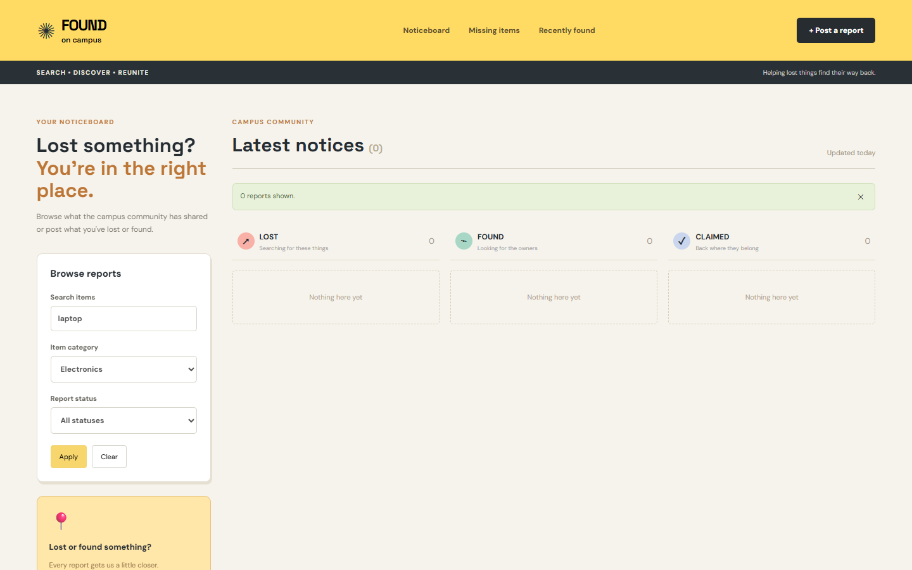
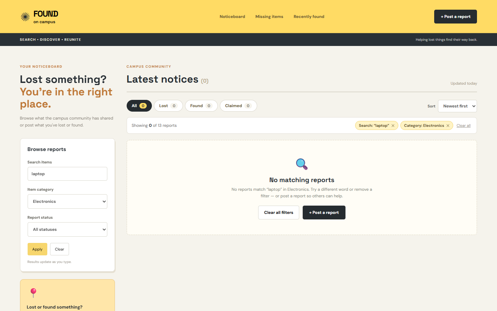
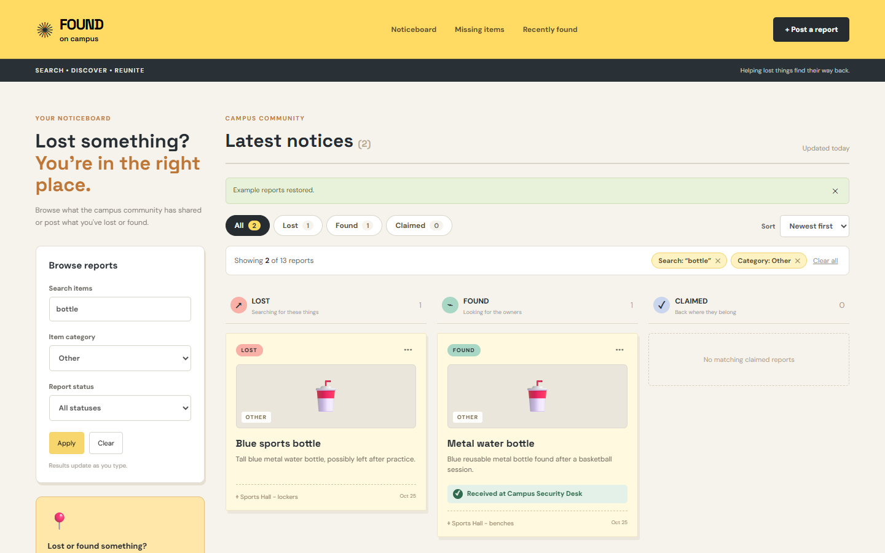
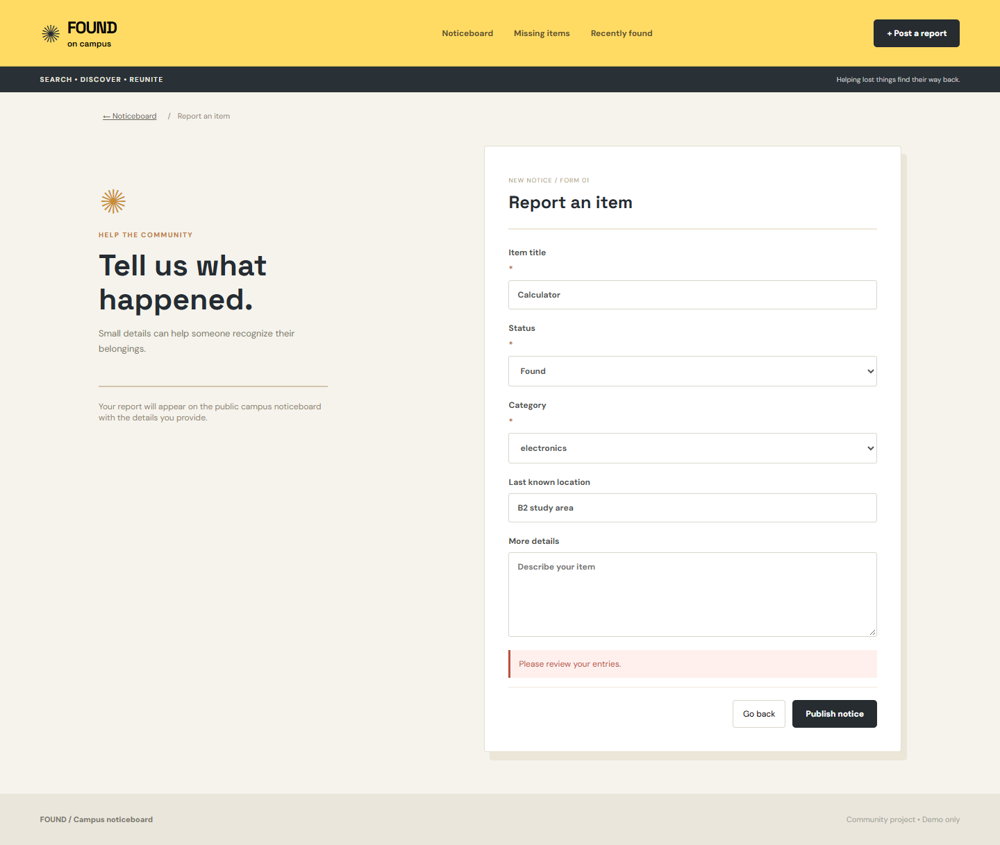

# FOUND – UI/UX Rescue Challenge Report

## 1. Project Overview

**FOUND on campus** is a standalone React (Vite) demo of a campus lost-and-found noticeboard. Students can browse, search and filter reports, post new **Lost**, **Found** or **Claimed** reports, and edit their own reports. Data is stored in the browser's `localStorage` (key `acl-foundboard-v3`). **Reset demo data** restores the 13 example records. There is no backend, MongoDB or API.

The brief has an important domain rule: a report saying an item was *found* is **not** the same as the item being *received* at a campus collection point. Each found card shows this handover state.

**Purpose of this task:** use the app as an end user, find three real usability problems, compare alternative fixes with AI assistance, then implement and test the chosen fixes. The existing visual identity (yellow, charcoal, warm neutrals, sticky-note cards) and all existing behaviour and validation had to stay intact.

---

## 2. Problem Identification

The three hypotheses supplied with the task were checked against the running app and the code (`src/App.jsx`, `src/styles.css`). All three were confirmed as genuine problems. While testing, one further defect was found in form validation feedback (Section 2.4).

### 2.1 Problem 1: Item cards are hard to recognise

| | |
|---|---|
| **User goal** | Scan the board and quickly decide "is that *my* item?", and for found items, "can I go and collect it?" |
| **Before** | Each card shows a 39 px emoji floating on a pastel note. The category is a 9 px grey caption. **Every newly created report gets the same generic 📌 emoji** whatever its category (code: `emoji: … : '📌'`), so a new "Grey hoodie" looks like any other new report (see `problem1-before.png`). A card's status is shown only by which column it sits in. The important handover line ("Received at Campus Security Desk" vs "Reported found – not confirmed at a collection point") is 10 px plain grey text, the same style as the description. |
| **Usability issue** | Recognition depends on reading small body text. New reports have no visual identity at all. Users can't easily tell whether a found item is actually waiting at a desk or has only been reported, which is the most important fact for someone planning to collect it. |
| **After** | Every card now has the same layout: a **status badge** (Lost / Found / Claimed, colour-matched to the column icons), then a **large, consistently sized media panel** (104 px high) tinted by category with a 52 px icon and a category label, then the title and description in larger text. Seeded reports keep their specific emoji. Reports without one (including old saved 📌 reports) **fall back to a category icon** (💻 👕 📄 👜 📦). The handover state is now a **colour-coded callout**: green ✓ *Received at …*, amber ! *Reported found – not confirmed at a collection point*, blue ✓ *Collected by owner*. The wording is unchanged. |
| **Why it is better** | Students recognise cards visually rather than by reading. Category and status are readable at a glance, including on a single-column mobile layout where the column heading may be off-screen. The found-vs-received distinction is now the most visible fact on found cards rather than the least. |

### 2.2 Problem 2: Hard to switch status and find recent reports

| | |
|---|---|
| **User goal** | Go straight to the relevant list (e.g. "show me everything *found*") and see the most recent notices first. |
| **Before** | Reports always appear as three fixed Lost / Found / Claimed columns. The header links **Missing items** and **Recently found** set the status filter but keep all three columns, so two columns read "Nothing here yet" (`problem2-before.png`). Below 1130 px the columns wrap 2 + 1. On a phone (390 px) everything stacks, and the **Found section starts 2,439 px down a 4,588 px page** (`problem2-before-mobile.png`). The section is titled "Latest notices", yet cards were in **oldest-first** order (Oct 23 at the top, newest at the bottom), and there was no way to change it. |
| **Usability issue** | Too much scrolling and scanning. The navigation shortcuts produce a confusing, mostly empty screen. The order contradicts the heading and hides the newest reports, which are the most likely matches for a student who has just lost something. |
| **After** | A **status tab bar** (All · Lost · Found · Claimed) sits above the board, and each tab shows a **live count** for the current search/category. The tabs drive the *same* state as the existing sidebar "Report status" select, so the two always stay in sync. Choosing a single status shows a **full-width responsive grid** of that status (`problem2-after.png`) instead of three columns with two empty. A **Sort** menu offers *Newest first* (default), *Oldest first* and *Title A–Z*. On a phone, one tap on **Found** brings the first found card to 1,123 px (`problem2-after-mobile.png`). |
| **Why it is better** | One tap switches status, and counts show where the matches are before the user even switches. The header shortcuts now produce a useful view. "Latest notices" now really shows the latest first. Mobile users no longer scroll past every lost item to reach the found ones. |

### 2.3 Problem 3: Weak search and filter feedback

| | |
|---|---|
| **User goal** | Understand what is currently filtering the board, how many reports match, and recover quickly when nothing matches. |
| **Before** | Filtering was already live (it updates while typing), so **Apply did nothing** except post a banner like "0 reports shown." That suggests the filters weren't applied until clicked, and the banner stayed after later changes. Nothing on the board showed which filters were active, and the count "(0)" gave no total. With zero matches, **all three columns said "Nothing here yet"** (`problem3-before.png`), which reads as "the board is empty" rather than "your filters excluded everything". Filters could only be reset all at once, from the sidebar. |
| **Usability issue** | Users can't see why results are missing, may think the board has no relevant reports and give up, and get no clear way to recover. |
| **After** | A **results bar** above the board reads "Showing **N** of **T** reports" (`aria-live="polite"` for screen readers). It lists each active filter as a **removable chip** (*Search: "bottle" ✕*, *Category: Other ✕*, *Status: Lost ✕*) plus **Clear all** (`problem3-after-chips.png`). Zero matches now show a dedicated **empty state** that names the filters ("No reports match "laptop" in Electronics."), with **Clear all filters** and **+ Post a report** buttons (`problem3-after.png`). **Apply** is kept and now has a real job: it scrolls to the results and highlights the results bar, which helps most on mobile where the results sit below the filters. Pressing **Enter** in the search box does the same. A hint, "Results update as you type", explains the live behaviour. **Clear** is disabled when there is nothing to clear. Empty columns in the All view say "No matching lost reports" when filters are active. |
| **Why it is better** | The system's state is always visible (Nielsen's heuristic #1). Users can undo one filter without losing the others. A dead end becomes a clear next step: broaden the search, or post a report. |

### 2.4 Additional defect found during inspection: validation messages discarded

`validate()` returns specific messages ("Title must be at least 2 characters.", "Choose a category.", "An item with the same title has already been reported at this location."). However, `submit()` threw them away and always showed **"Please review your entries."** (`validation-before.png`), so a user who hit the duplicate rule had no idea why the form failed. The fix shows the specific message: `setError(v)` (`validation-after.png`). **The validation rules themselves are unchanged.** This was a one-line fix, so it's reported separately rather than counted as one of the three improvements.

---

## 3. Alternatives and Design Decisions

### Problem 1: Item identification

| Option | Advantages | Disadvantages |
|---|---|---|
| **A. Uploaded item photographs** | Most precise way to recognise an item | Base64 images in `localStorage` would hit the ~5 MB browser quota after a few photos. Privacy risk on a public board (ID cards, personal items). Needs crop/resize/upload UI and moderation. Seed data has no photos, so most cards would still need a fallback |
| **B. Detailed category-specific illustrations** | Attractive and consistent | Requires new art assets. Still generic (every backpack looks the same). Adds maintenance work for limited gain |
| **C. Larger, consistent image area with category fallback + status/handover badges** ✅ | Works for 100 % of records today. No storage or privacy risk. Fixes the 📌 defect. Gives every card the same scannable layout. Pure CSS/JSX with no new dependencies | Category icons are generic, so the description is still needed for fine detail |

**Selected: C.** It fixes the real defects (generic 📌, inconsistent visuals, buried status and handover information) within the project's constraints. Because every card has a dedicated media slot, real photos could be added later without another redesign.

### Problem 2: Discovery and navigation

| Option | Advantages | Disadvantages |
|---|---|---|
| **A. Status tabs** ✅ | One tap to switch. Counts show where matches are. Fixes the empty-columns problem from the header links | Duplicates the sidebar status select (mitigated by sharing one state) |
| **B. Sorting options (newest first)** ✅ | Fixes the misleading oldest-first order. Cheap | Does nothing for switching between statuses on its own |
| **C. Compact list view** | Very dense, fast to scan | Loses the noticeboard character and visual recognition from Problem 1. A second layout to maintain |

**Selected: A + B.** Tabs fix switching and scrolling, and sorting fixes ordering. They solve different parts of the problem and each is small. The compact list was rejected because it would undo the recognition gains from Problem 1.

### Problem 3: Search and filter feedback

| Option | Advantages | Disadvantages |
|---|---|---|
| **A. Matching-results counter** ✅ | Constant, cheap feedback ("Showing 2 of 13") | Doesn't say *why* results are limited or how to undo it |
| **B. Active filter chips** ✅ | Shows exactly what is filtering. Each filter can be removed alone | Adds a row of UI (only visible when filters are active) |
| **C. Automatic filtering (remove Apply)** | Already true in the code | Removing Apply would remove a required existing feature, and on its own it gives no feedback |

**Selected: A + B, plus a recovery-focused empty state.** Apply is **kept** and given a real job instead of being removed (see Section 4).

---

## 4. AI-Assisted Development

AI (Claude) was used to:

1. **Audit the code against the hypotheses.** Reading `App.jsx` showed facts that screenshots alone would miss: new reports are hard-coded to `📌`, filtering is already live so Apply is a no-op, the seed order is oldest-first, and `submit()` discards `validate()`'s specific message.
2. **Generate and compare alternatives.** At least three options per problem, with trade-offs weighed against the project's constraints (no backend, `localStorage` only, preserve every feature).
3. **Implement the changes** following the file's existing compact JSX style and the existing colour tokens.
4. **Write and run a 35-step end-to-end browser test** (headless Chrome driven through the DevTools Protocol, typing into and clicking the real UI), then capture every screenshot in this report from the running app.

### A suggestion that was rejected

- **Original AI suggestion (Problem 1):** "Add an image upload field to the report form, convert the photo to base64 and store it with the report in `localStorage`."
- **Why it was not ideal:** browsers give `localStorage` only about 5 MB per origin, and a few phone photos would exceed it and break saving for *every* report. Photos on a public noticeboard create privacy problems: the seed data already includes a *Student ID card*, which should never be photographed publicly. It also needs resizing, cropping and moderation, which a standalone demo can't provide. And all 13 seeded reports would still have no image.
- **Alternative selected:** a consistent, larger media panel with category-tinted backgrounds, a category-based fallback icon, and prominent status and handover badges.
- **Why it is better here:** it works for every existing and new record, can't exhaust storage, has no privacy risk, adds no dependencies, and keeps a slot where real photos could be added if a backend is introduced later.

### A suggestion that was refined

- **Original AI suggestion (Problem 3):** "Filtering is already automatic, so remove the Apply button."
- **Refinement:** Apply is listed as existing functionality and must be kept. Instead it was given a meaningful job: it scrolls to the results and highlights the results summary, and Enter in the search box triggers it. A one-line hint ("Results update as you type") removes the confusion about whether filters need to be applied.

---

## 5. Implementation Details

**Modified files**

| File | Change |
|---|---|
| `src/App.jsx` | +51 / −7 lines. Helpers, derived state, card renderer, tabs, sort, results bar, chips, empty state, specific validation message |
| `src/styles.css` | +48 lines, appended in three commented sections (P1 / P2 / P3). No existing rule was removed |
| `UI_UX_IMPROVEMENT_REPORT.md` | This report (new) |
| `screenshots/ui-ux-rescue/*.png` | 16 genuine screenshots (new) |

**Components / logic changed (all inside the single `App` component, as in the original)**

- **New helpers:** `categoryIcons` and `iconFor()` (fallback icon, also handles legacy 📌 records). `handover()` (same three wordings as before, plus a style `kind`). `timeOf()`, `shownDate()` and `sorts` (sortable dates). `columns` (the column metadata, moved into a constant so the single-status view can reuse it).
- **New state:** `sortBy` (default `newest`), `flash` (Apply highlight), `resultsRef`.
- **Derived data:** `scoped` (search + category) is now separate from `filtered` (+ status + sort), so the tabs can show per-status counts. `chips` lists the active filters.
- **New functions:** `clearFilters()` (shared by Clear, Clear all and the empty state; also dismisses a stale banner). `apply()` (form submit: scroll + highlight). `emptyText()`.
- **Card rendering:** `card()` renders the status badge, media panel, title, description, handover callout and footer. It is shared by the three-column and single-status views.
- **Filter panel:** now a `<form>` so Enter applies. The search input is `type="search"`, and the status options show capitalised labels (values unchanged).
- **Create:** new reports store `createdAt: Date.now()` (for sorting) and an empty `emoji` (so the category fallback is used). Edits keep the existing emoji, as before.
- **Validation:** `setError(v)` replaces `setError('Please review your entries.')`. `validate()` is untouched.
- **Reset demo:** also resets the sort to *Newest first*.

**CSS added:** `.status-badge`, `.sticky-media` (+ `cat-*` tints), `.media-label`, coloured `.handover-note.received / .reported / .released`, `.board-toolbar`, `.status-tabs` / `.status-tab[aria-pressed]`, `.sort-control`, `.status-grid`, `.results-bar` (+ `.flash`), `.chip`, `.clear-all`, `.empty-results`, `.filter-hint`, and responsive rules under 750 px. All colours reuse the existing palette (`#ffdb64`, `#262c30`, `#f5f3ec`, `#f9b0a6`, `#a8d7c6`, `#cad6ed`, …). Focus-visible outlines use the brand yellow.

**Accessibility:** tabs use `role="group"` and `aria-pressed`. Chips have `aria-label="Remove filter …"`. The results bar is `aria-live="polite"`. Decorative icons are `aria-hidden`.

**Dependencies added:** none. `package.json` is unchanged.

---

## 6. Testing and Validation

**Method:** the dev server (`npm run dev`) was started and headless Google Chrome was driven through the Chrome DevTools Protocol from a Node script. Each test types into or clicks the real UI (React-controlled inputs receive genuine `input`/`change` events) and then asserts on the rendered DOM and on `localStorage`. Every run starts from a fresh browser profile. `npx vite build` also completed without errors.

The first run gave **33 / 35**. One failure was a bug in the test script (a duplicated variable name). The other was a **real regression**: the new tab bar made the page 442 px wide on a 390 px phone. It was fixed (shorter "All" label, tighter mobile tabs, `min-width: 0` guards), and the final run gave **35 / 35 passed**.

| # | Test case | Expected result | Actual result | Pass/Fail |
|---|---|---|---|---|
| 1 | Browse all reports | 13 seed cards, "Showing 13 of 13 reports" | 13 cards; "Showing 13 of 13 reports" | ✅ Pass |
| 2 | Search by item title ("calculator") | Only the 2 calculator reports | Scientific calculator, Calculator | ✅ Pass |
| 3 | Search shows chip + count | Chip "Search: "calculator"", "Showing 2 of 13" | As expected | ✅ Pass |
| 4 | Clear filters | All 13 back, search empty, no chips | 13 cards, 0 chips | ✅ Pass |
| 5 | Filter by category (Electronics) | 5 electronics cards only | 5 electronics cards | ✅ Pass |
| 6 | Filter by status via sidebar select (Found) | Found tab selected, 6 cards in single-status grid | Found tab pressed, 6 cards | ✅ Pass |
| 7 | Filter by status via tab (Lost) | Sidebar select becomes "lost", 6 cards | select = lost, 6 cards | ✅ Pass |
| 8 | Tab counts follow search ("bottle") | All 2, Lost 1, Found 1, Claimed 0 | 2,1,1,0 | ✅ Pass |
| 9 | Remove one filter chip (Category) | Category reset, search "bottle" kept | 2 → 1 chips, search kept | ✅ Pass |
| 10 | Apply filters (button) | Results highlighted / scrolled into view | Results bar highlighted | ✅ Pass |
| 11 | Apply via Enter in search form | Same as Apply | Highlighted | ✅ Pass |
| 12 | Empty search result ("laptop" + Electronics) | Empty state naming the filters | "No reports match "laptop" in Electronics. …" | ✅ Pass |
| 13 | Empty state "Clear all filters" | 13 cards return | 13 cards | ✅ Pass |
| 14 | Sort newest first (default, Found tab) | USB flash drive (Oct 27) first | USB flash drive first | ✅ Pass |
| 15 | Sort oldest first | Oct 24 report first, USB drive last | Dark backpack … USB flash drive | ✅ Pass |
| 16 | Sort title A–Z | Alphabetical | Calculator, Dark backpack, … | ✅ Pass |
| 17 | Header "Missing items" | Lost tab, single grid, no empty columns | As expected | ✅ Pass |
| 18 | Header "Recently found" | Found tab selected | 6 found cards | ✅ Pass |
| 19 | Found vs received distinction preserved | Received / Reported-not-confirmed / Collected shown correctly; none on lost cards | ✓ Received at Campus Security Desk / ! Reported found – not confirmed… / ✓ Collected by owner | ✅ Pass |
| 20 | Supported categories & statuses unchanged | 5 categories, 3 statuses in form | lost,found,claimed / electronics,clothing,documents,accessories,other | ✅ Pass |
| 21 | **Create a Lost report** ("Grey hoodie", clothing, Gym changing room) | Success message, card at top of Lost, 👕 icon | "Your report has been posted.", top of Lost, 👕 | ✅ Pass |
| 22 | **Create a Found report** with optional fields empty ("Silver ring") | Saved; "Location not provided", "No additional description.", *Reported found – not confirmed* | As expected, 👜 icon | ✅ Pass |
| 23 | **Persistence after refresh** | Both new reports still shown; localStorage has 15 | 15 cards, localStorage 15 | ✅ Pass |
| 24 | **Reject title "A"** | Error "Title must be at least 2 characters.", stays on form | As expected | ✅ Pass |
| 25 | Reject "  B  " (1 char after trim) | Same error | As expected | ✅ Pass |
| 26 | Invalid report not saved | No "A"/"B" card; localStorage still 15 | localStorage 15 | ✅ Pass |
| 27 | Missing category | "Choose a category." | As expected | ✅ Pass |
| 28 | **Duplicate** "calculator" @ "b2 STUDY area" (case differs) | "An item with the same title has already been reported at this location." | As expected | ✅ Pass |
| 29 | Same title at a different location | Allowed | Posted | ✅ Pass |
| 30 | Only own reports editable | Other's card: "Reported by another student"; own: "Edit your report" | As expected | ✅ Pass |
| 31 | Edit own report (Black backpack description) | Form prefilled, "Report updated.", new text shown, emoji kept | As expected, 🎒 kept | ✅ Pass |
| 32 | Inject legacy saved record with 📌 | (setup step) | Injected | ✅ Pass |
| 33 | Legacy 📌 record falls back to category icon | 📄 for documents | 📄 | ✅ Pass |
| 34 | Reset demo data | 13 cards, localStorage 13, "Example reports restored.", filters + sort reset | As expected | ✅ Pass |
| 35 | Mobile 390 px: no horizontal scroll | `scrollWidth` ≤ 390 | 390 | ✅ Pass |

Demonstration screenshots from the same run: `demo-a1-form-filled.png`, `demo-a2-report-posted.png`, `demo-a3-after-refresh.png` (scenario A), and `demo-b1-short-title-error.png`, `demo-b2-duplicate-error.png` (scenario B).

---

## 7. Before-and-After Comparison

All screenshots were captured from the running application (headless Chrome, 1440 × 900 desktop or 390 × 844 mobile). The **before** images were taken from the original, unmodified code before any change was made. The full set is in `screenshots/ui-ux-rescue/`.

### Comparison 1: Item identification

| Before | After |
|---|---|
|  |  |
| The new "Grey hoodie" report shows a generic 📌. Status is implied only by the column. Category and handover state are small grey text. | The hoodie shows a 👕 clothing icon in a consistent media panel, with a **LOST** badge and a category label. Found/claimed cards show colour-coded handover callouts (amber "not confirmed", blue "Collected by owner"). |

**Benefit:** faster visual recognition, and a clear answer to "is this item actually waiting at a desk?"

### Comparison 2: Discovery and navigation

| Before | After |
|---|---|
|  |  |
| "Missing items" leaves two empty "Nothing here yet" columns, cards in oldest-first order, single narrow column of results. | Lost tab selected with count, a full-width grid of lost items, newest first, and a Sort menu. |
|  |  |
| Mobile, full page: Found starts 2,439 px down a 4,588 px page. | Mobile: one tap on **Found** shows only found items, with counts on every tab. |

**Benefit:** one-tap switching between statuses, less scrolling, and the newest notices first.

### Comparison 3: Search and filter feedback

| Before | After |
|---|---|
|  |  |
| "laptop" + Electronics: three "Nothing here yet" boxes and a "0 reports shown." banner from Apply. No indication of which filters caused it. | "Showing 0 of 13 reports", removable chips for each filter, and an empty state naming the filters with **Clear all filters** / **+ Post a report**. |

Chips with results: 

**Benefit:** the filter state is always visible, filters can be removed one at a time, and zero results lead to a clear next step.

### Extra: specific validation message

| Before | After |
|---|---|
|  |  |
| Duplicate report → generic "Please review your entries." | Invalid title → "Title must be at least 2 characters." (and the duplicate rule's own message, see `demo-b2-duplicate-error.png`). |

---

## 8. Conclusion

The three improvements target the core student journey: *find my item, or tell people I found theirs*.

1. **Recognisable cards.** A consistent media panel, category fallback icons (no more generic 📌), status badges and colour-coded handover callouts let students recognise items, and see whether a found item is really waiting at a collection point, without reading small print.
2. **Status tabs and sorting.** One-tap switching between Lost, Found and Claimed (with live counts), useful header shortcuts, a full-width single-status grid and newest-first ordering cut scrolling, especially on phones.
3. **Visible filter feedback.** A results counter, removable filter chips, a meaningful Apply, and a recovery-focused empty state make filtering transparent and stop dead ends.

All existing features (browse, search, category and status filters, Apply, Clear, create Lost/Found, owner-only edit, duplicate prevention, title-length validation, supported categories and statuses, optional fields, `localStorage` persistence, Reset demo, and the found-vs-received distinction) were preserved and checked in 35 automated browser tests. No dependencies were added, and the FOUND visual identity is kept.

**Known limitations**

- Category icons are representative, not item-specific. Real photos would need a backend for storage and moderation.
- Seed dates have no year, so they are treated as 2026 for sorting. New reports use precise timestamps. As in the original, editing a report marks it as updated "Today" (it now also moves to the top under *Newest first*).
- The status filter is reachable from both the tabs and the sidebar select. Both were kept deliberately (they share one state) so no existing control was removed.
- Tests were automated in headless Chrome only. Other browsers and real assistive technology were not tested.
