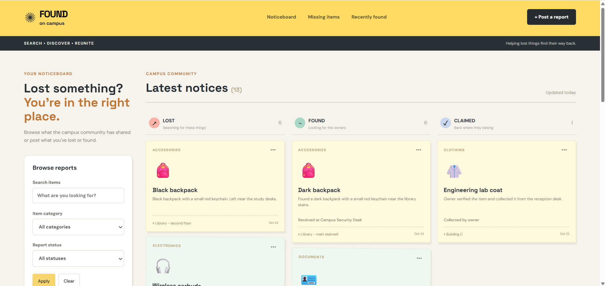
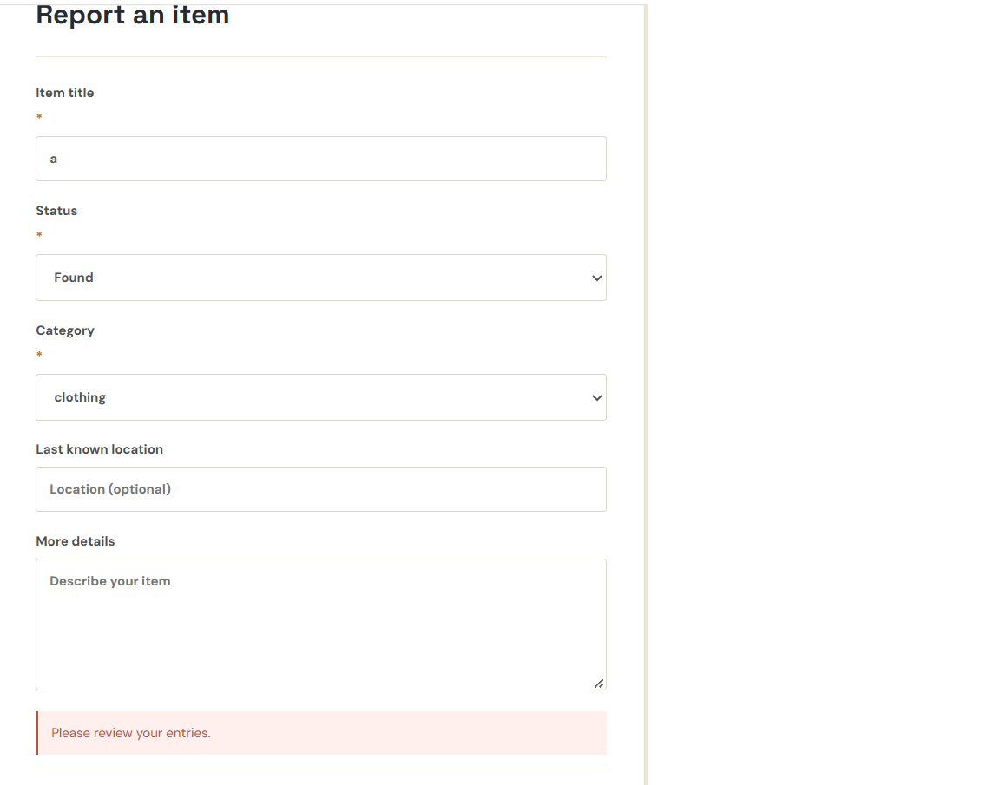
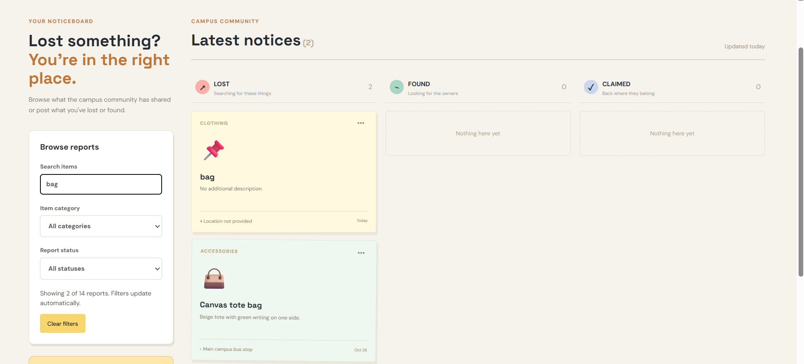
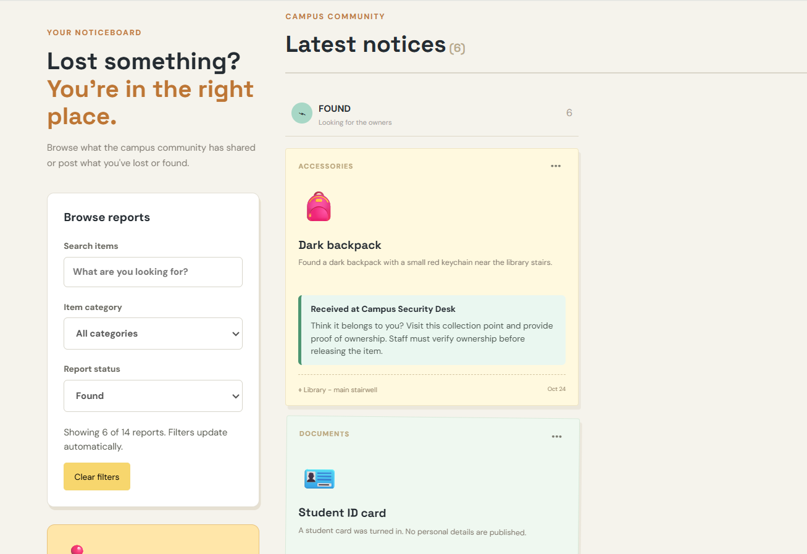
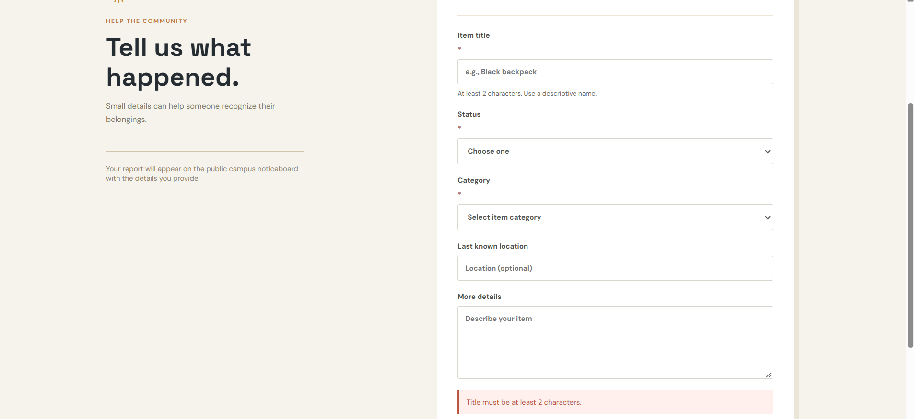

# UI/UX Rescue Challenge — Campus Lost & Found

## User goals

A student who has lost an item wants to find a matching
notice and understand where to recover it.

Another student wants to report a found item clearly
and successfully.

## Improvement 1 — Search and filtering

Problem:
The Apply button suggests that users need to submit
their filters, even though results already update
automatically. Empty results lack useful guidance.

Solution:
Removed the misleading Apply action, added a live
result count, a clear-filters option and a helpful
empty-results message.

Why:
Users can understand the search results and easily
recover when their filters return nothing.

## Improvement 2 — Recovery guidance

Problem:
Users cannot easily understand whether a found item
has been handed to staff or how to recover it.

Solution:
Added contextual recovery guidance for received,
reported and claimed items.

Why:
Students can see the correct next step without
assuming every found item is already held by staff.

## Improvement 3 — Form validation

Problem:
The form displayed a generic error even though
the application had specific validation messages.

Solution:
Displayed the actual validation message and added
guidance for the required title field.

Why:
Students can understand and correct invalid entries
without guessing what went wrong.

## AI alternatives and trade-offs

1. Filtering:
   Considered manual Apply versus live filtering.
   Chose live filtering because the records are local
   and results can update immediately.

2. Recovery:
   Considered a Claim Now button versus contextual
   recovery instructions.
   Chose instructions because the demo cannot
   verify real ownership.

3. Validation:
   Considered a generic error banner versus specific
   validation messages.
   Chose specific messages because they tell users
   exactly what to correct.

## AI suggestion rejected

I rejected adding a Claim Now button because it
could imply that clicking a button completes an
ownership-verification process.

Instead, I added guidance explaining that campus
staff must verify ownership before releasing items.

## Testing

- [ ] Search and filters work
- [ ] Empty-results message works
- [ ] Recovery guidance displays correctly
- [ ] New report can be published
- [ ] Duplicate reports are rejected
- [ ] Existing reports remain editable only by owners
- [ ] Reports persist after refreshing
- [ ] Reset demo works
- [ ] npm run build succeeds

## Screenshot evidence

### Original interface

### Redesigned interface

