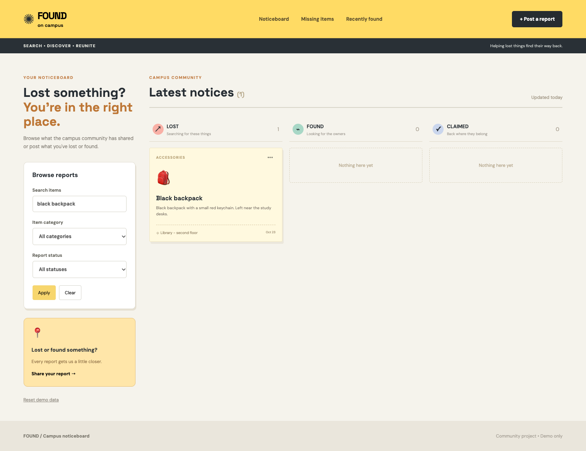
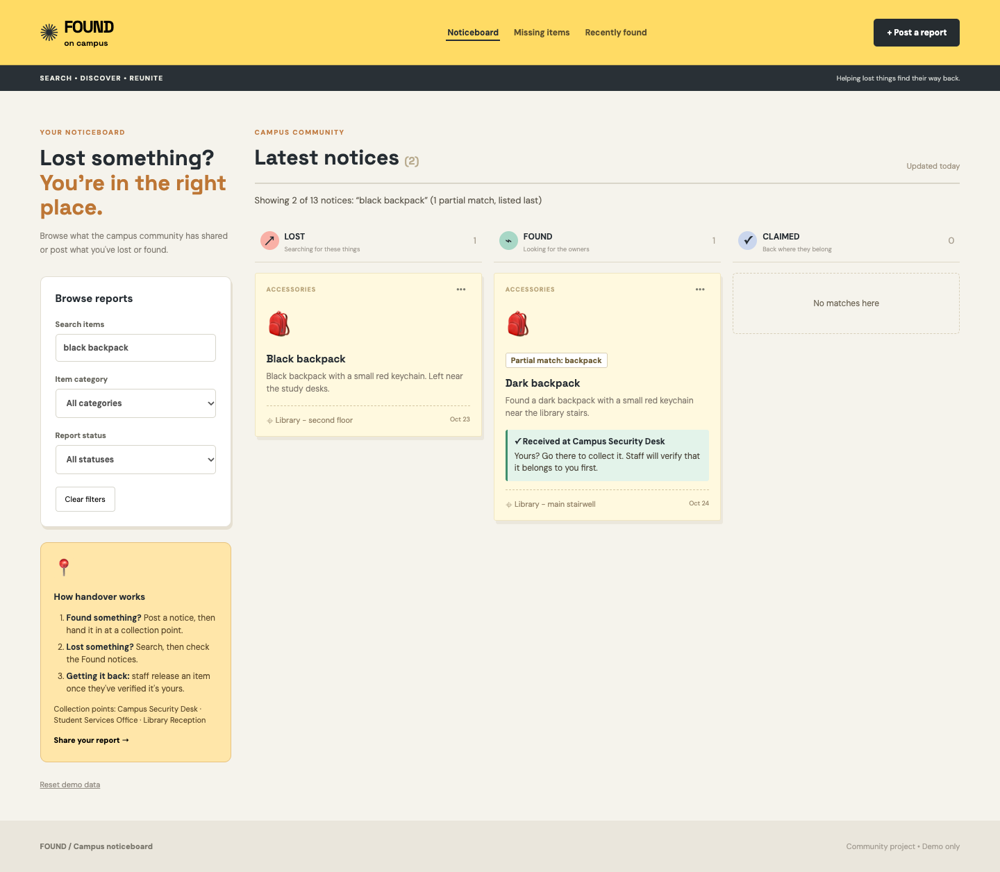
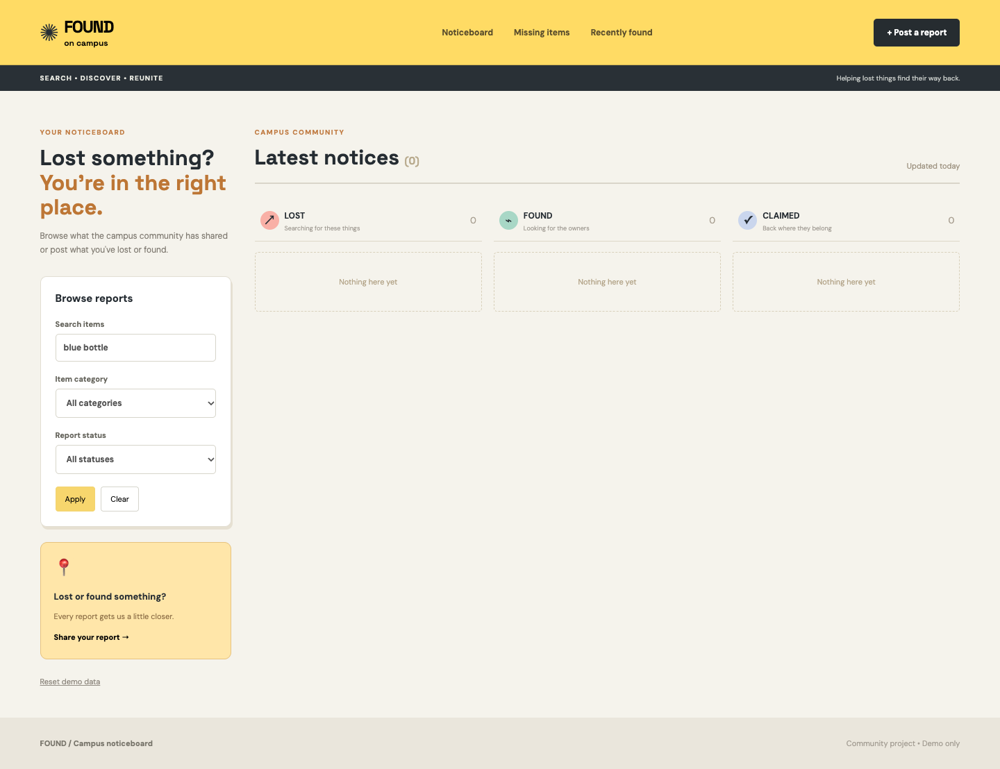
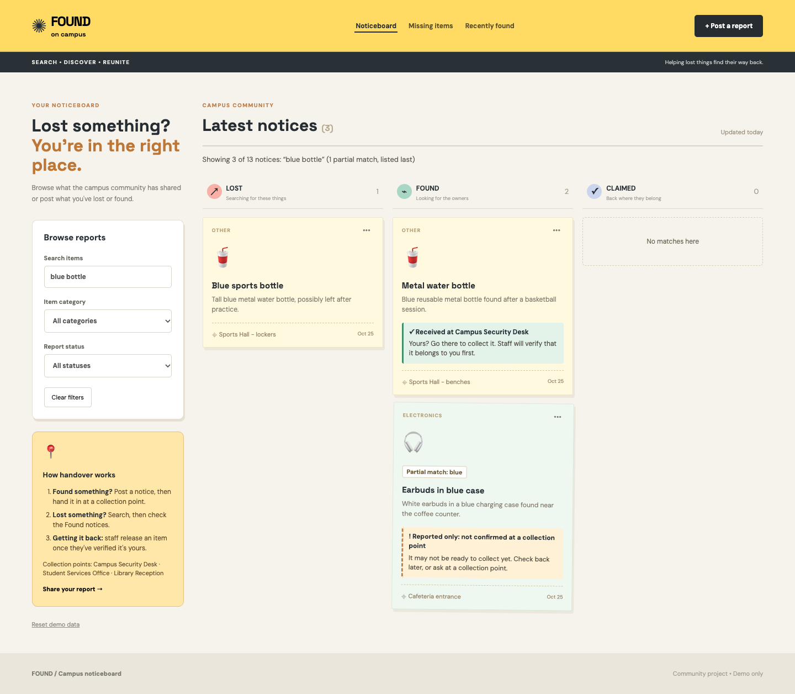
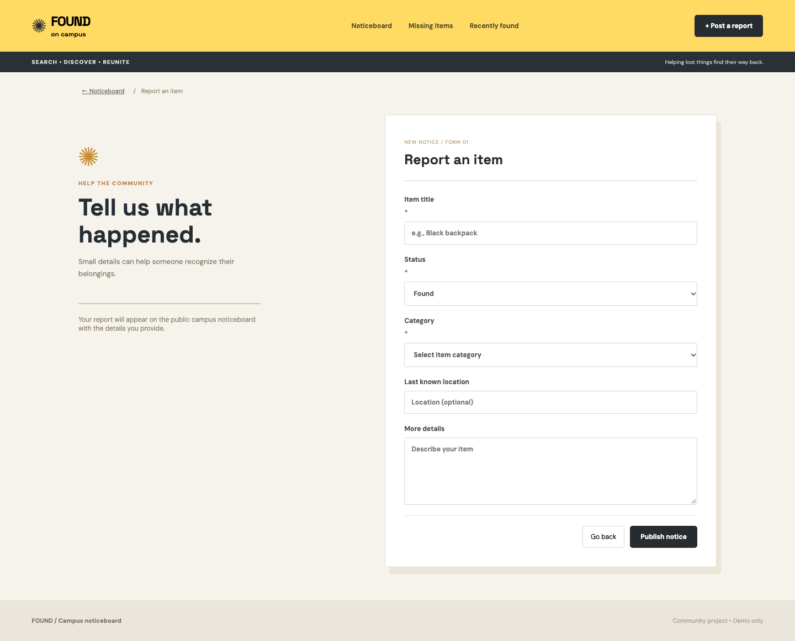
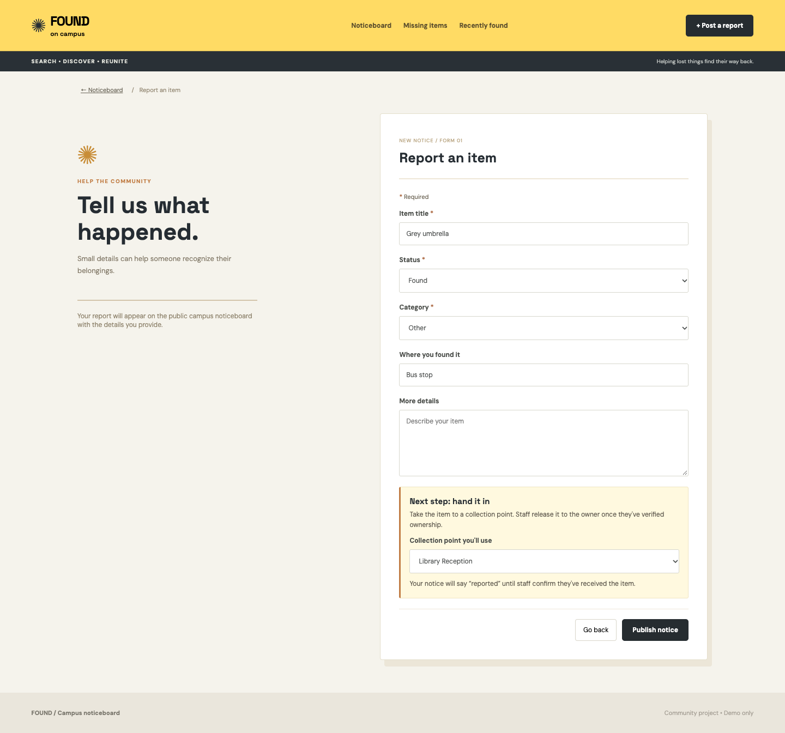
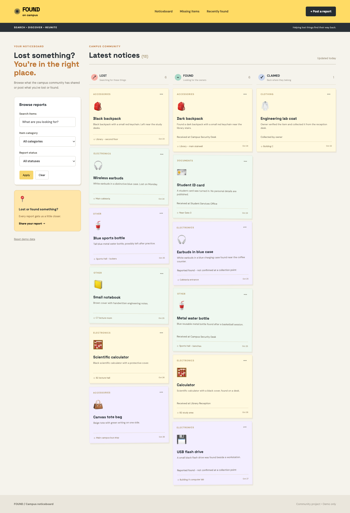
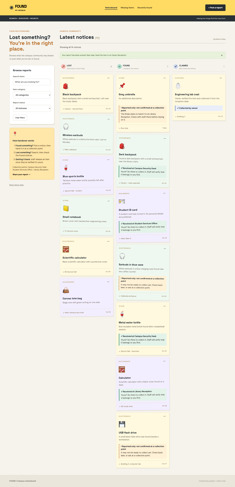
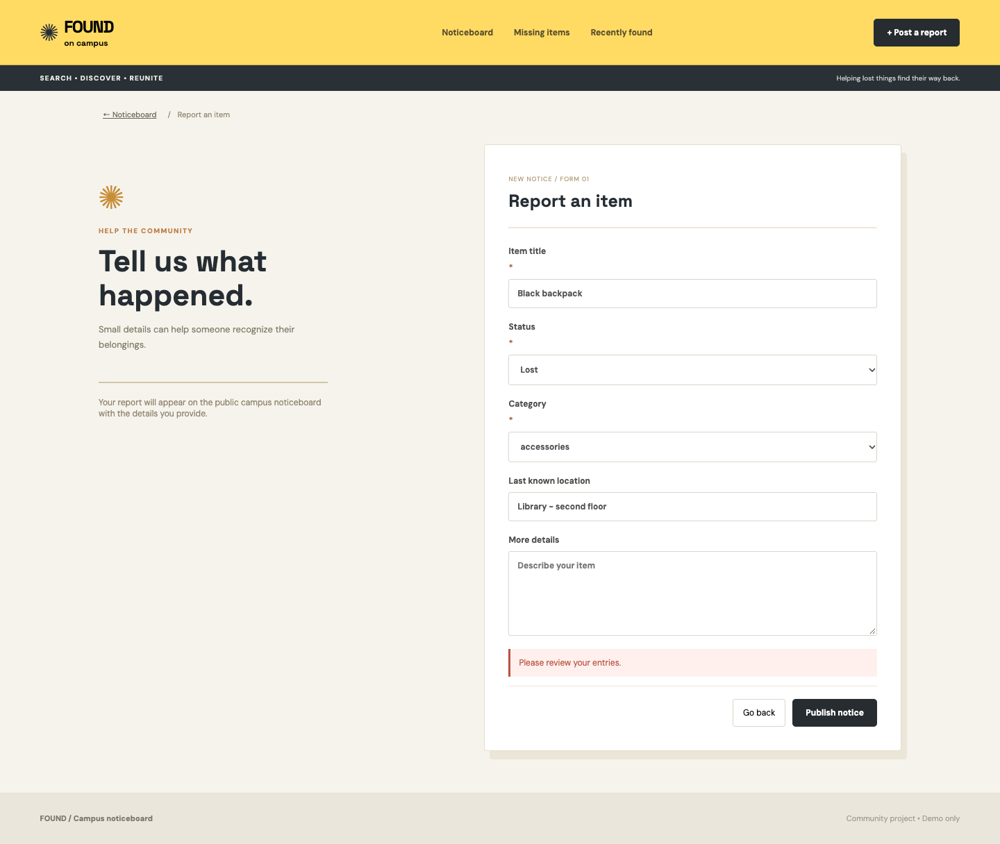
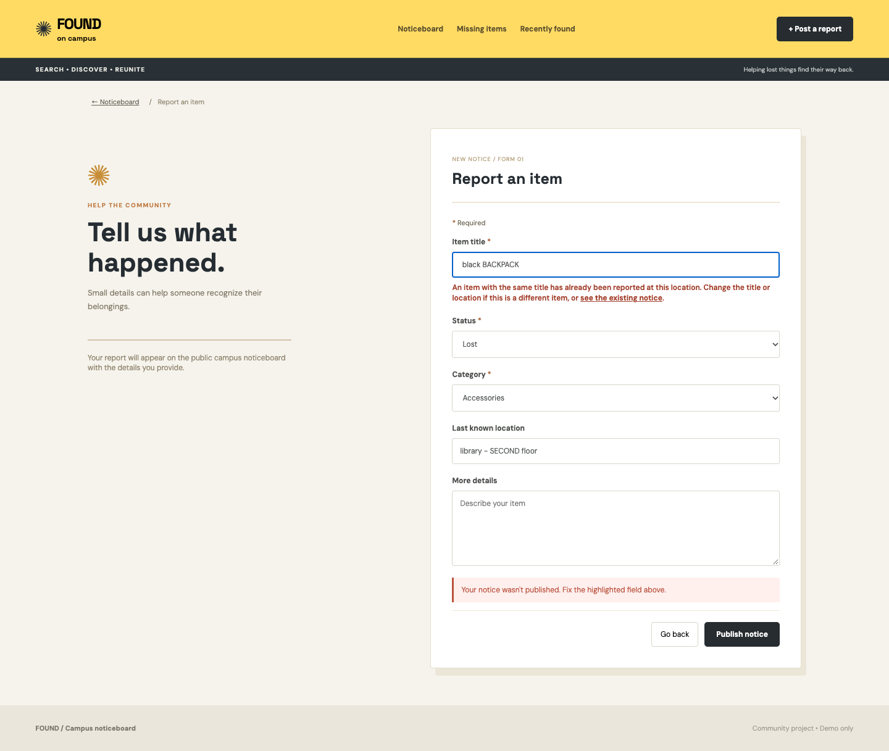

# Campus Lost & Found: UI/UX Rescue submission

> **Draft prepared with Claude.** The brief expects AI assistance, but the reasoning you submit is yours. Read the decisions below and change any you disagree with before submitting.

**Modified React files:** `src/App.jsx`, `src/styles.css`
**Screenshots:** `submission/screenshots/`
**Repeatable checks:** `submission/tests/check-app.mjs`

## Three brief justifications

### 1. Search and filters hid the notice the student needed

**User's goal:** someone who lost an item wants to find a matching notice.

**Why it hurt:** search only matched the exact phrase typed. "black backpack" missed the found "Dark backpack" with the same red keychain, and "blue bottle" returned nothing even though two reports describe blue bottles. The student would reasonably conclude that nobody had found the item. "Apply" did nothing because filters already update live, "Noticeboard" stayed stuck on a filter, and hidden columns said "Nothing here yet".

**What changed:** search now handles word order and plurals, ranks exact and all-word matches first, and labels weaker matches "Partial match". A live summary replaces Apply, the navigation shows the current view and "Noticeboard" shows everything. A failed search now offers next steps, including a lost report with the search words already filled in.

| Before | After |
| --- | --- |
|  |  |
|  |  |

No results: `after-4-no-results.png`. Navigation: `before-4-noticeboard-still-filtered.png` and `after-5-recently-found-view.png`.

### 2. The collection-point process was invisible

**User's goal:** a finder needs to know what to do with the item. An owner needs to know how to get it back.

**Why it hurt:** collection points are how property changes hands on campus, yet the report form never mentioned them. Cards showed "Received at..." and "not confirmed" in the same small grey text with no next step, so a student could make a wasted trip for an item staff don't have. Marking a lost report as claimed even displayed "Reported found".

**What changed:** choosing Found reveals a handover step in the form, with an optional collection point. Cards now separate staff-confirmed items from reported-only items using wording, icon and colour, and each one says what to do next. A short panel in the sidebar explains the process and names the collection points.

| Before | After |
| --- | --- |
|  |  |
|  |  |

### 3. Failed submissions didn't say what was wrong

**User's goal:** publish a report, or understand why it can't be published.

**Why it hurt:** every failure showed "Please review your entries." The validator already knew the reason and the app threw it away. A student blocked by the duplicate rule could check every field, see nothing wrong, and give up.

**What changed:** each problem now appears beside its field, all at once, and focus moves to the first one. Errors clear as they are fixed. The duplicate error explains what to change and links to the existing notice. The rules themselves are unchanged.

| Before | After |
| --- | --- |
|  |  |

Several errors at once: `after-8-empty-submit-errors.png`.

## Alternatives compared before implementing

### Problem 1: search

| Option | Advantage | Drawback | Decision |
| --- | --- | --- | --- |
| Every word must match, in any order | Predictable, few results | Still misses "Dark backpack" | Kept as the top tier |
| Any word matches | Finds "Dark backpack" | 5 of 13 notices for "black backpack", including calculators and a flash drive | Refined (see below) |
| Fuzzy search library such as Fuse.js | Tolerates typos | New dependency, ranking is hard to explain | Rejected |
| Automatic "possible matches" panel | Least effort for the student | Suggests a match the system can't verify, and is the largest build | Rejected for this session |
| Keep Apply and make it control filtering | Results change less often | Adds a step to something that already works live | Rejected |

### Problem 2: collection points

| Option | Advantage | Drawback | Decision |
| --- | --- | --- | --- |
| Static help text only | Cheap, no data changes | The owner can't see where the finder is heading | Used in part |
| Finder picks a point and the notice says "Received at X" | Simple, looks complete | Breaks the brief: a report is not staff confirmation | **Rejected** |
| Finder states a planned point and the notice stays "reported" | Honest, reuses existing data fields, optional | More text on cards | **Chosen** |
| Full claim workflow with a staff role | Most complete | Needs accounts and a backend the demo doesn't have | Out of scope |

### Problem 3: validation

| Option | Advantage | Drawback | Decision |
| --- | --- | --- | --- |
| Show the real message in the existing banner | One-line fix | One error at a time, far from the field | Rejected |
| Errors at each field on submit, focus the first | Shows everything at once, works with assistive technology | More markup | **Chosen** |
| Validate while typing | Immediate feedback | Errors appear before the student has finished | Used only after the first failed submit |

## An AI design suggestion that was rejected

**Suggestion:** add a collection-point dropdown to the found form, and have the notice display "Received at [point]".

**Decision:** rejected. It is the simplest design and looks finished, but the brief says a reported item is not automatically confirmed as being held by staff. A student's dropdown choice would appear as staff confirmation, and an owner could travel to a desk that doesn't have the item.

**What replaced it:** the finder can name where they plan to go, and the notice keeps saying "Reported only: not confirmed at a collection point" along with that plan. Details staff have already confirmed can't be changed from the edit form.

**Second example, if you prefer it (refined):** plain any-word search returned 5 of 13 notices for "black backpack", including calculators and a flash drive. Requiring a partial match's word to appear in the title reduced this to the 2 relevant notices and still found "Dark backpack".

## Demonstration script

Press **Reset demo data** first.

1. **Main action, lost item:** search `black backpack`. "Dark backpack" appears with a "Partial match" label, and its card says it was received at Campus Security Desk.
2. **Main action, found item:** choose **+ Post a report**. Enter title `Grey umbrella`, status Found and category Other. The handover step appears, so choose Library Reception and publish. The message gives the next step, and the card still says "Reported only".
3. **Unsuccessful action:** choose **+ Post a report**. Enter `Black backpack`, Lost, Accessories, `Library - second floor`, then publish. The notice isn't published, the reason appears under the title, and the link opens the existing notice.
4. **Improvements:** 1 and 2 above show search and handover. Step 3 shows validation. To show search with no results, try `wallet`. To show navigation, click **Recently found**, then **Noticeboard**.

## Testing

- **Automated:** 78 checks passed in headless Chrome, using the 13 example records. 21 of them confirm existing behaviour still works and 57 cover the new behaviour, edge cases and layout.
- **Real keyboard input:** typed a search, submitted the empty form with Enter, fixed a field and tabbed onward in Chromium.
- **Layout:** no sideways scrolling at 1024, 768, 390 or 320 px wide.
- **Other:** the production build succeeds and the run produced no console errors or warnings.
- **Not tested:** Safari, Firefox, a physical phone or a screen reader. Accessibility attributes were checked, but not with assistive technology.

Behaviour confirmed preserved: text, location and description search; category and status filters; Clear; create and edit; editing only your own reports; `localStorage` persistence; Reset; the two-character title rule; the required status and category; and the duplicate rule, including allowing the same title at a different location.

## Behaviour that intentionally changed

- **Apply removed:** filters were already live, and it only displayed a count that could go out of date. The summary above the board replaces it.
- **Noticeboard and the logo** now clear the status filter.
- **Search returns more results,** with weaker matches labelled and listed last.
- **Filtering to one status** hides the other columns, which used to say "Nothing here yet".
- **Saving a report clears filters** so the saved report is visible.
- **Editing a report keeps its original date.** It used to change to "Today".
- **Claimed reports** without staff confirmation now read "Marked as claimed by the reporter".

## Known limits, not changed

- **Search has no synonyms or typo tolerance:** "bag" won't find "backpack", and "backpak" finds nothing.
- **Unsaved text:** Go back discards what you typed without warning.
- **Editing is hard to find:** it stays behind the "···" menu, and your own reports look like everyone else's.
- **No staff role in the demo:** nothing can move a report from "reported" to "received".
- **New reports can still be created as Claimed,** because the brief lists that status and removing it could weaken a feature.
